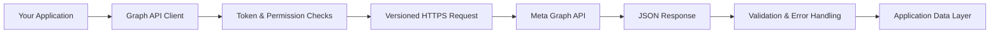
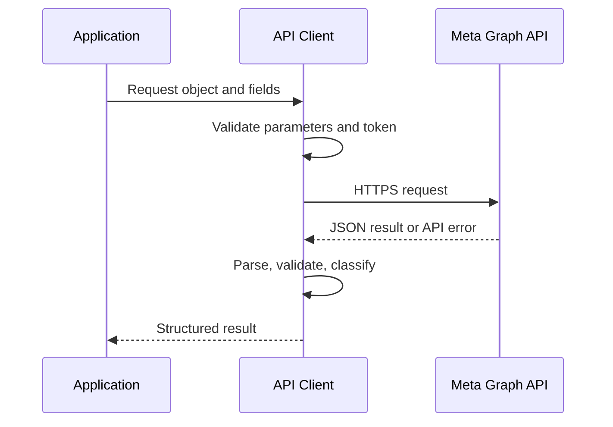

<div align="center">


<br/>

<a href="https://share.google/tZImwDnkOo7x7umir"></a>
&nbsp;
<a href="https://share.google/tZImwDnkOo7x7umir"></a>
&nbsp;
<a href="https://share.google/tZImwDnkOo7x7umir"></a>

<br/><br/>


</div>

---

## 🌠 Meet Facebook Graph API Client

**Facebook Graph API Client** is a developer-focused integration project for interacting with the **Meta Graph API**. The Graph API provides a structured interface for reading and managing data that an app is authorized to access, including supported Facebook Page resources, posts, comments, insights, and other platform objects depending on the permissions and products configured for the application.

Instead of treating every endpoint as a separate integration problem, a well-designed client centralizes request construction, authentication, pagination, response parsing, and error handling. This makes social-platform integrations easier to maintain and more predictable across development, testing, and production environments.

This repository's documentation explores the concepts and implementation patterns that matter most when building with the Graph API: **nodes, edges, fields, tokens, permissions, pagination, rate limits, and webhooks**.

---

## 🪄 Six Building Blocks

<table align="center" width="100%">
<tr>
<td align="center" width="33%"><h3>🧿 Graph Objects</h3><p>Understand nodes such as Pages, posts, and comments and how their identifiers are used.</p></td>
<td align="center" width="33%"><h3>🪢 Connections</h3><p>Traverse supported edges to discover related objects and collections.</p></td>
<td align="center" width="33%"><h3>🧰 Field Selection</h3><p>Request only the fields your integration needs for cleaner responses.</p></td>
</tr>
<tr>
<td align="center"><h3>🗝️ Token Handling</h3><p>Work with appropriately scoped access tokens without exposing credentials.</p></td>
<td align="center"><h3>🧭 Pagination</h3><p>Process multi-page results using the paging information returned by the API.</p></td>
<td align="center"><h3>🪄 Event Updates</h3><p>Use supported webhook subscriptions for timely application workflows.</p></td>
</tr>
</table>

---

## 🗺️ How the Graph API Is Organized

The API models resources as a graph. A **node** represents an individual object, an **edge** represents a connection or collection associated with that object, and a **field** represents an attribute of an object.

| Concept | Meaning | Example pattern |
|:--|:--|:--|
| Node | An individual resource | `/{object-id}` |
| Edge | Related objects | `/{page-id}/posts` |
| Field | Selected properties | `?fields=id,name` |
| Version | Explicit API contract | `/v{version}/...` |
| Token | Authorization context | `Authorization: Bearer ...` |
| Paging | Cursor-based continuation | `paging.cursors` or `paging.next` |

The exact fields and edges supported for any object depend on the API reference and the permissions associated with the request.

### Architecture overview



---

## 🛠️ Getting Started with a Graph API Integration

### 1. Create and configure a Meta app

Use the [Meta for Developers](https://developers.facebook.com/) dashboard to create an app and configure the relevant product. Select the permissions and access type appropriate to your intended integration. Some capabilities require business verification or app review before they can be used beyond development roles.

### 2. Obtain an appropriate access token

Graph API calls are authorized using access tokens. Different endpoints can require user, Page, or other supported token types. The token must have the required permissions and be valid for the requested operation.

**Never commit access tokens to GitHub.** Store them in environment variables or a secrets manager, and rotate any credential that has been exposed.

### 3. Choose an API version

Use an explicitly supported Graph API version rather than assuming that an older version will remain available. Review the official changelog when upgrading an integration.

### 4. Send a first read request

The following example illustrates a minimal authenticated request for the `me` object, subject to token type and granted permissions:

```bash
export GRAPH_API_VERSION="vXX.X"  # Replace with a supported version
export META_ACCESS_TOKEN="YOUR_ACCESS_TOKEN"

curl --get \
  "https://graph.facebook.com/${GRAPH_API_VERSION}/me" \
  --header "Authorization: Bearer ${META_ACCESS_TOKEN}" \
  --data-urlencode "fields=id,name"
```

The placeholder version must be replaced with a currently supported version before running the request.

### 5. Inspect the JSON response

Successful responses return JSON objects or collections. Errors generally include a structured error object with details that can help diagnose authorization, endpoint, or request problems.


---

## 🐍 Python Example: A Minimal Request Wrapper

This standalone example demonstrates a reusable pattern for GET requests. It does **not** imply that this repository already includes a Python package with this exact interface.

```python
import os
import requests


class GraphAPIClient:
    def __init__(self, access_token: str, api_version: str):
        self.access_token = access_token
        self.base_url = f"https://graph.facebook.com/{api_version}"
        self.session = requests.Session()
        self.session.headers.update({
            "Authorization": f"Bearer {access_token}"
        })

    def get(self, endpoint: str, **params):
        url = f"{self.base_url}/{endpoint.lstrip('/')}"
        response = self.session.get(url, params=params, timeout=20)
        response.raise_for_status()
        return response.json()


client = GraphAPIClient(
    access_token=os.environ["META_ACCESS_TOKEN"],
    api_version=os.environ["GRAPH_API_VERSION"],
)

print(client.get("me", fields="id,name"))
```

For production use, add structured logging with credential redaction, retries with backoff for eligible transient failures, permission-aware error handling, and explicit pagination logic.

---

## 📦 Pagination and Large Result Sets

Some collection endpoints return a subset of results and a `paging` object. Cursor-based pagination allows an integration to continue processing without assuming that every result fits into one response.

```python
# Illustrative processing of an API response
payload = client.get("PAGE_ID/posts", fields="id,message")

for item in payload.get("data", []):
    print(item.get("id"), item.get("message"))

next_page = payload.get("paging", {}).get("next")
print("Has next page:", bool(next_page))
```

When following a `paging.next` URL, use only a URL returned by the trusted Graph API response, keep the request within the intended API host, and ensure credentials are not logged. Handle empty collections and expired cursors gracefully.

---

## 🧪 Practical Integration Scenarios

### Facebook Page Management

With the appropriate Page access and permissions, integrations may retrieve supported Page metadata, publish eligible content, or work with Page-related objects. Exact operations depend on the endpoint and app configuration.

### Content Analytics

Eligible insights endpoints can provide metrics for authorized Page or content objects. Data availability, metric definitions, and retention rules vary; verify the current documentation for each metric.

### Moderation Workflows

Supported comments and related objects can help teams build dashboards for review and response. Any automated action should be permission-aware, auditable, and consistent with Meta platform policies.

### Internal Reporting

A client can normalize authorized API data into internal reports, dashboards, or scheduled data pipelines. Record timestamps, API versions, and metric definitions to keep reports interpretable over time.

### Event-Driven Integrations

Webhooks can reduce the need for continuous polling when the relevant object and event subscriptions are supported. Verify callback requests and handle retries and duplicate events.

---

## 🧯 Error Handling Playbook

| Symptom | Possible cause | Recommended action |
|:--|:--|:--|
| Authentication failure | Invalid or expired token | Verify token validity and token type |
| Permission error | Missing scope or app approval | Review required permissions and access level |
| Unknown field or edge | Unsupported resource or version | Check endpoint reference and requested fields |
| Rate limiting | Too many requests | Back off and use supported usage headers |
| Empty collection | No accessible data or no matching records | Confirm object ID, permissions, and filters |
| Webhook delivery issue | Invalid callback or verification | Inspect callback configuration and verification logic |

Do not automatically retry every error. For example, a missing permission generally requires a configuration or authorization change rather than repeated requests.

---

## 🔐 Security and Privacy Practices

- **Use least-privilege permissions.** Request only the capabilities your app genuinely needs.
- **Keep tokens private.** Avoid placing tokens in source files, screenshots, logs, or public URLs.
- **Use HTTPS.** Do not send tokens or sensitive response data over insecure channels.
- **Respect data access rules.** Access only information that the application is authorized to use.
- **Minimize retention.** Store only necessary data and follow applicable platform and privacy requirements.
- **Verify webhooks.** Validate authenticity before processing incoming events.
- **Monitor API changes.** Review deprecations and migration notices before upgrading.
- **Build observability.** Log request IDs, statuses, and timings without exposing private data.

---

## ⚙️ Designing a Reliable Client

| Design goal | Implementation pattern | Benefit |
|:--|:--|:--|
| Consistency | Shared request wrapper | Less duplicated HTTP logic |
| Maintainability | Explicit API version | Predictable upgrades |
| Reliability | Timeouts and selective retries | Better failure recovery |
| Efficiency | Field selection and pagination | Less unnecessary data transfer |
| Security | Secrets manager and token redaction | Lower credential exposure risk |
| Testability | Mocked HTTP responses | Repeatable integration tests |
| Observability | Structured, sanitized logs | Faster incident diagnosis |

### Recommended project organization

```text
facebook-graph-api-client/
├── README.md
├── .env.example
├── src/
│   ├── client.py
│   ├── auth.py
│   ├── pagination.py
│   └── errors.py
├── examples/
│   ├── read_profile.py
│   └── list_page_posts.py
└── tests/
    ├── test_client.py
    └── test_errors.py
```

*This tree is a suggested architecture, not a verified inventory of repository files.*

---

## 🧵 Request Lifecycle



---

## 📈 Performance and Maintenance Tips

**Request only what you need.** Use field selection instead of fetching every possible attribute. Reduce redundant calls by caching permitted data according to its freshness requirements and Meta's applicable data policies.

**Treat pagination as normal.** Avoid hardcoding the number of pages or assuming the first response is complete.

**Design for changing permissions.** A working request in development does not guarantee production access. Build informative failure states and document permission prerequisites.

**Test errors deliberately.** Simulate expired tokens, malformed responses, network timeouts, unavailable endpoints, and rate limits.

**Review version changes.** Graph API versions and product capabilities evolve; schedule compatibility checks before the version you use is retired.

---

## ❔ Frequently Asked Questions

<details>
<summary><b>What is the Facebook Graph API?</b></summary>

It is Meta's HTTP-based interface for accessing supported platform objects and connections, subject to authorization, permissions, and platform policies.

</details>

<details>
<summary><b>Can I retrieve data from any Facebook account?</b></summary>

No. Access depends on the available endpoints, granted permissions, applicable authorization, and platform rules. A client cannot bypass those restrictions.

</details>

<details>
<summary><b>What is the difference between a node and an edge?</b></summary>

A node represents an object, while an edge represents a relationship or collection associated with an object. Fields select attributes to return.

</details>

<details>
<summary><b>Why should I specify an API version?</b></summary>

Versioning makes the API contract more predictable and helps you plan upgrades when fields, endpoints, or permissions change.

</details>

<details>
<summary><b>Why does my access token work for one endpoint but not another?</b></summary>

Endpoints can require different token types, permissions, or app access levels. Check the documentation for the specific operation.

</details>

<details>
<summary><b>How do I handle a large number of records?</b></summary>

Use the pagination data returned by the endpoint, request only required fields, and respect the applicable usage limits.

</details>

<details>
<summary><b>Are webhooks available for every Graph API object?</b></summary>

No. Webhook support depends on the product, object type, and subscription. Confirm the supported events in Meta's documentation.

</details>

<details>
<summary><b>Where can I find the authoritative endpoint specifications?</b></summary>

Consult the Meta for Developers Graph API documentation, including the relevant product guides, permissions reference, and changelog.

</details>


---

## 🌌 Closing Notes

**Facebook Graph API Client** brings together the essential ideas behind reliable Meta platform integrations: clear API contracts, authorized data access, careful token management, predictable error handling, and maintainable client architecture.

Whether you are prototyping a dashboard, building a Page-management workflow, or integrating analytics into an internal service, understanding the Graph API's structure is the foundation for a dependable implementation.

<div align="center">


</div>
